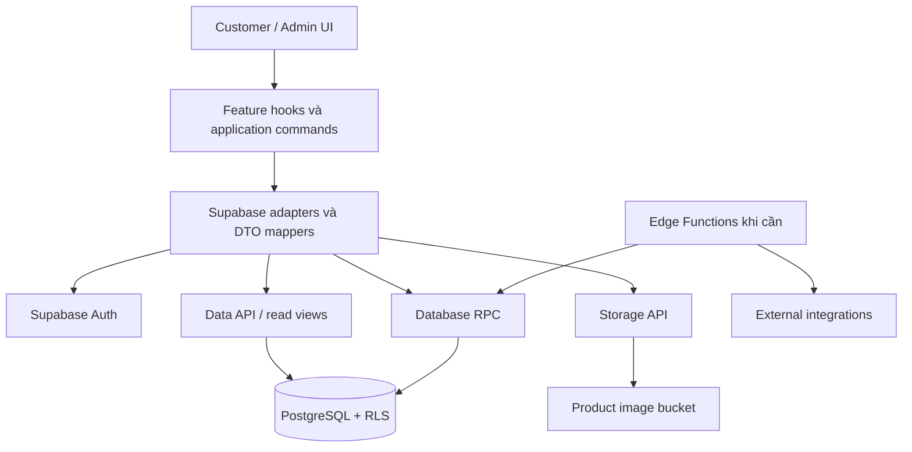

# MIRA RENT — nền móng phát triển backend

Tài liệu này xác định kiến trúc backend, hợp đồng dữ liệu và thứ tự triển khai cho source hiện tại. Các phần ghi **đề xuất** hoặc **cần triển khai** chưa phải chức năng đang chạy. Khi bắt đầu một giai đoạn, đối chiếu lại migration và source trước khi viết code.

**Cập nhật implementation:** SDK/adapters Supabase, providers theo mode, write commands, self-access/snapshot RPC và tests đã được tạo. [supabase/SETUP.md](supabase/SETUP.md) là hướng dẫn chạy và trạng thái triển khai hiện tại. Các contracts/path minh họa bên dưới là bản thiết kế ban đầu; hợp đồng đang compile nằm trong `src/services/contracts/index.ts`. Frontend mặc định vẫn chạy demo; cloud chưa được kết nối khi thiếu env.

## 1. Hiện trạng và tài liệu gốc

| Thành phần | Hiện có | Việc tiếp theo |
| --- | --- | --- |
| React/TypeScript/Vite | Frontend đã tách pages, layouts, features, services | Kết nối adapters, giữ giao diện và URL |
| Business logic | Hàm thuần cho CRUD, giá thuê, transitions, doanh thu | Giữ để preview; database xác nhận kết quả ghi |
| Auth | Demo hoặc Supabase Auth/self-access theo mode | Kiểm chứng bằng project và tài khoản thật |
| Data | Demo repository hoặc snapshot/commands RPC | Kiểm chứng permissions trên Supabase cloud |
| Images | Object URL demo hoặc Storage adapter UUID paths | Kiểm chứng upload/reload qua dịch vụ thật |
| Database | Bốn migrations, RLS, RPC, seed, SQL tests | Áp dụng lên project test và kiểm chứng dịch vụ thật |
| Backend cloud | Chưa kết nối hoặc triển khai | Thực hiện theo các giai đoạn bên dưới |

- [Kiến trúc frontend](ARCHITECTURE.md).
- [Schema, ERD và cách chạy Supabase](supabase/README.md).
- [Schema/RLS](supabase/migrations/20261012000001_mira_schema.sql).
- [Commands/RPC](supabase/migrations/20261012000002_mira_commands.sql).
- [Storage policies](supabase/migrations/20261012000003_mira_storage.sql).

SQL migrations là nguồn chuẩn cho tên bảng, cột, tham số và constraints. Generated Database types phải lấy từ project đã migrate. Tài liệu này không thay thế migrations bằng một bộ schema khác.

## 2. Phạm vi nghiệp vụ ban đầu

Backend phục vụ một shop. Một product là một đơn vị quản lý cho thuê; một rental order có một product. Mỗi product có tối đa một đơn reserved/active. Khách xem catalogue và liên hệ shop; admin nhập thông tin khách, xử lý đơn và ghi nhận doanh thu.

| Module | Trách nhiệm |
| --- | --- |
| Identity & access | Đăng nhập, đăng xuất, khôi phục phiên, kiểm tra admin membership |
| Catalogue | Đọc sản phẩm, tìm/lọc, lưu metadata, archive sản phẩm |
| Media | Upload, chọn bìa, thứ tự ảnh, archive metadata, cleanup orphan |
| Rentals | Đặt, thuê trực tiếp, bắt đầu, hủy đặt, hoàn tất |
| History | Đọc snapshot và audit, giữ bản ghi đã hoàn tất |
| Revenue | Tổng hợp actual revenue của completed orders |
| Settings | Cấu hình shop dùng chung với website khách hàng |

Booking tự phục vụ, nhiều món trong một đơn, kho theo size, CRM, thanh toán online và nhiều shop là các phần mở rộng riêng. Chỉ thêm khi có yêu cầu nghiệp vụ và migration tương ứng.

## 3. Kiến trúc mục tiêu



Định hướng giai đoạn đầu là Supabase làm backend: Auth quản lý danh tính, Data API cung cấp reads, PostgreSQL RPC thực hiện write transactions, Storage lưu ảnh. Adapters nằm trong frontend là lớp truy cập backend, không phải nơi quyết định quyền hoặc dữ liệu cuối cùng. RLS và grants bảo vệ dữ liệu tại database; xem [Supabase API security](https://supabase.com/docs/guides/api/securing-your-api).

Chỉ bổ sung Edge Functions cho xử lý cần secret, webhook hoặc tích hợp bên ngoài. Chọn TypeScript cho lớp này; nền tảng Edge Functions hỗ trợ runtime tương thích Deno. Giai đoạn đầu các nghiệp vụ hiện có đã được bao phủ bằng SQL RPC. Tham khảo [Supabase Edge Functions](https://supabase.com/docs/guides/functions).

## 4. Ranh giới code khi triển khai

Cấu trúc dưới đây là định hướng phân trách nhiệm. Implementation hiện có trong src/services/supabase; product/rental/settings writes dùng chung commands.ts, snapshots dùng read-repository.ts. functions/ vẫn là phần mở rộng khi cần.

```text
src/services/
  contracts/                       # hợp đồng reads và commands
  demo/                            # backend mode demo riêng
  supabase/
    client.ts                      # một client dùng chung
    database.types.ts              # generated từ schema thật
    errors.ts                      # chuẩn hóa lỗi từ SDK/RPC
    auth-adapter.ts                # session + admin access
    read-repository.ts             # catalogue, history, analytics
    product-commands.ts            # save_product, archive_product
    rental-commands.ts             # các RPC rental
    settings-commands.ts           # save_shop_settings
    image-storage.ts               # Storage API và cleanup
    mappers/                       # snake_case ↔ domain models

supabase/
  migrations/                      # schema và nghiệp vụ nguyên tử
  tests/                           # quyền, constraints, concurrency
  functions/                       # chỉ thêm khi có nhu cầu
    _shared/                       # auth, validation, errors, logging
```

Quy tắc phụ thuộc: UI → feature hooks → service contracts → adapters. SQL migrations không phụ thuộc React. Components không gọi SDK trực tiếp. Dữ liệu từ SDK được kiểm tra/map trước khi vào domain state.

## 5. Chuyển từ demo store sang backend

Hiện `DataRepository.save(state: ShopState)` ghi một snapshot demo. Khi dùng database thật, thay hợp đồng ghi thành từng command. Upsert cả ShopState sẽ ghi đè thay đổi của admin khác và không phù hợp với lịch sử immutable hoặc grants hiện tại.

| Hiện tại | Hướng chuyển |
| --- | --- |
| repository.load() | loadPublic hoặc loadAdmin sau khi xác định quyền |
| repository.save(ShopState) trong useEffect | Gọi command ngay ở action, nhận kết quả server |
| mutate reducer trước rồi persist | Ban đầu chờ server xác nhận rồi cập nhật state |
| AuthAdapter.hasSession() trả boolean | Auth state có phase và admin access rõ ràng |
| ImageStorageAdapter.upload(files) | Thêm product UUID và upload context |
| resetDemo trên repository chung | Chỉ tồn tại trong demo mode; production không có reset toàn bộ dữ liệu |

Không dùng effect tự lưu toàn state để thực thi RPC. Một action hợp lệ phải phát sinh đúng một command; render, StrictMode hoặc hydrate không được tạo giao dịch.

Sau thành công, map row server trả về, giữ version mới và refresh các dữ liệu liên quan. Sau thất bại, giữ form/ý định của người dùng, không đánh dấu thành công và không âm thầm chuyển sang dữ liệu demo. Chặn submit lặp trong lúc request đang pending.

Ở bước đầu ưu tiên cập nhật sau xác nhận server. Nếu sau này thêm optimistic UI, phải có rollback và reconcile với version/database state; reducer local và PersistenceQueue không thay thế concurrency control giữa nhiều admin.

## 6. Hợp đồng ứng dụng đề xuất

Ví dụ TypeScript dưới đây mô tả ranh giới gọi backend; đây chưa phải file được compile trong dự án. Các payload RPC cụ thể vẫn theo migration.

```ts
interface Versioned<T> {
  data: T;
  version: number;
}

interface ProductEntity extends Versioned<Product> {
  databaseId: string; // UUID thật, dùng cho Storage paths
}

interface PublicBootstrap {
  products: ProductEntity[];
  settings: Versioned<ShopSettings>;
}

interface AdminBootstrap extends PublicBootstrap {
  orders: Versioned<RentalOrder>[];
}

interface BackendReads {
  loadPublic(): Promise<PublicBootstrap>;
  loadAdmin(): Promise<AdminBootstrap>;
}

interface RentalCommands {
  createRental(input: {
    productRef: string;
    requestId: string;
    draft: RentalDraft;
    startImmediately: boolean;
  }): Promise<Versioned<RentalOrder>>;

  startRental(input: {
    orderCode: string;
    expectedVersion: number;
    draft?: Partial<RentalDraft>;
  }): Promise<Versioned<RentalOrder>>;

  cancelReservation(input: {
    orderCode: string;
    expectedVersion: number;
  }): Promise<Versioned<RentalOrder>>;

  completeRental(input: {
    orderCode: string;
    expectedVersion: number;
    draft: CompletionDraft;
  }): Promise<Versioned<RentalOrder>>;
}
```

Product, RentalOrder, ShopSettings, RentalDraft và CompletionDraft tham chiếu các types hiện có trong `src/types` và `src/features/rentals/drafts.ts`. Product/settings commands cần hợp đồng tương tự với expectedVersion; storage image DTO phải giữ id, product UUID, storagePath hoặc externalUrl và thứ tự ảnh.

Version là metadata của entity, không phải giá trị người dùng chỉnh trong form. AdminBootstrap là dữ liệu bootstrap ban đầu; khi số lượng đơn tăng, history/analytics cần query riêng có phân trang thay vì tải mọi đơn vào bộ nhớ.

## 7. Reads và mapping dữ liệu

| Tác vụ | Nguồn dữ liệu |
| --- | --- |
| Trang chủ / collection / detail | product_catalog, product_images active |
| Header / footer / contact | shop_settings |
| Quản lý đơn | rental_orders, lọc reserved/active |
| Lịch sử hoàn tất | rental_history |
| Audit một đơn | rental_events theo order UUID |
| Báo cáo tháng | revenue_by_month |
| Giao dịch theo khoảng ngày | rental_orders completed, lọc completed_at |

Catalogue đang hoạt động luôn lọc deleted_at=null, kể cả khi admin có quyền đọc archived rows. Images lọc deleted_at=null và order theo sort_order. Khi phân trang, dùng thứ tự xác định như created_at + id hoặc completed_at + id; không giả định mọi row đã được trả về trong một response.

Các điểm map bắt buộc:

- Product.id lấy frontend_id để giữ `/san-pham/1`…`/san-pham/8`; lưu UUID thật bên cạnh cho Storage.
- RentalOrder.id lấy order_code; productId lấy ID tương thích trong product_snapshot.
- ProductImage.url resolve external_url hoặc getPublicUrl(storage_path).
- Snapshot có coverStoragePath phải resolve sang coverUrl khi dựng ProductSnapshot; không thay snapshot bằng metadata product mới.
- ShopSettings.owner map từ owner_name; các camelCase khác map tường minh từ snake_case.
- Tiền dùng số nguyên đồng; kiểm tra miền số nguyên an toàn trước khi gửi. Date inputs dùng YYYY-MM-DD, không chuyển qua timestamp UTC làm lệch ngày.
- Timestamps sự kiện giữ ISO timezone. Bộ lọc báo cáo theo ngày/tháng của shop phải chuyển ranh giới Việt Nam thành interval timestamp phù hợp; không chỉ slice ngày UTC để tính tháng.

Client phải phân biệt kết quả rỗng hợp lệ và quyền truy cập bị từ chối. Không lấy việc đọc được catalogue, có session hoặc nhận zero rental rows làm bằng chứng là admin.

## 8. Write APIs hiện có

| Command | RPC | Payload quan trọng |
| --- | --- | --- |
| Thêm/sửa product | save_product | p_product, p_images, p_expected_version |
| Xóa khỏi catalogue | archive_product | p_product_ref, p_expected_version |
| Đặt/thuê trực tiếp | create_rental | product reference, ngày thuê/trả, khách/cọc/notes, p_start_immediately, p_request_id |
| Bắt đầu thuê | start_rental | p_order_code, p_expected_version, p_draft |
| Hủy đặt | cancel_reservation | p_order_code, p_expected_version |
| Hoàn tất | complete_rental | code/version, ngày trả, phụ phí, giảm giá, actual revenue, notes |
| Lưu settings | save_shop_settings | p_settings, p_expected_version |

Ví dụ create_rental đã có trong [Supabase README](supabase/README.md#các-rpc-cho-adapter). Không cần dựng thêm một bộ REST endpoints cho cùng các writes ở giai đoạn đầu.

RPC tạo đơn lấy product/price snapshots từ database. Client không gửi product_snapshot, suggested_price hoặc rental_days làm kết quả có thẩm quyền. Product metadata write không gửi status hoặc legacy_id. Thay trạng thái product qua rental commands.

Create requestId được tạo một lần cho mỗi ý định tạo đơn và tái sử dụng khi timeout/retry. Một ý định mới dùng key mới. Giữ requestId cho đến khi đã xác định request thành công hay thất bại; sau timeout không lập tức sinh key khác rồi gửi lại.

Start/cancel/complete dùng version đang đọc. Retry một completion phải giữ nguyên các khoản tiền và notes của lần gửi trước. Khi gửi actual revenue=0, đó là quyết định manual ghi nhận 0; khi muốn database tính gợi ý, mapper có thể bỏ p_actual_revenue hoặc gửi null theo RPC. Model CompletionDraft hiện tại luôn có actualRevenue nên adapter cần chọn rõ cách diễn giải.

## 9. Identity và authorization

Định hướng dùng Supabase Auth cho tài khoản admin. Auth xác định người dùng; admin membership xác định quyền làm việc với dữ liệu shop. Xem [Supabase Auth](https://supabase.com/docs/guides/auth).

Luồng cần triển khai:

1. Bootstrap ở trạng thái loading, khôi phục session qua SDK.
2. Nếu có session, kiểm tra admin access phía server.
3. Admin hợp lệ mới loadAdmin và vào các route quản trị; tài khoản thường chỉ loadPublic.
4. Subscribe auth state changes. Khi logout hoặc mất phiên, clear orders, entity versions và cache riêng của admin, rồi tải public state.
5. Mọi command vẫn được SQL kiểm tra require_admin; route guard chỉ phục vụ trải nghiệm UI.

**Đã có:** migration 04 cung cấp get_admin_access(), chỉ trả isAdmin/role của caller. load_shop_snapshot(p_admin) trả một snapshot đọc thống nhất; admin scope yêu cầu membership. Frontend gọi hai RPC này, không truyền user ID tùy ý hoặc đọc bảng membership trực tiếp.

Auth adapter Supabase đã có getAccess/subscribe bên cạnh signIn/signOut/hasSession; provider quản lý authLoading và admin access. Session tồn tại không đồng nghĩa có quyền admin. Cấp/thu hồi membership qua SQL Editor hoặc tooling tin cậy; không cho client tự ghi role.

Các nhãn DEMO MODE, dữ liệu bootstrap demo và nút reset phải phụ thuộc backend mode. Khi mode là supabase, không gọi resetDemo hoặc dùng sessionStorage demo để quyết định quyền. Giữ layout/styles hiện có khi cập nhật chỉ báo mode cho phù hợp chức năng thật.

## 10. Media lifecycle

1. Cấp UUID product ngay khi mở form thêm mới, trước upload. Với product legacy, lấy databaseId từ ProductEntity.
2. Cấp UUID mới cho từng ảnh, validate JPEG/PNG/WEBP và tối đa 8 MiB.
3. Upload với upsert=false vào `products/<product-uuid>/<image-uuid>.<extension>`.
4. Trả Storage DTO cho editor; chỉ Object URL preview là dữ liệu tạm của trình duyệt.
5. Submit metadata/images/cover trong save_product. Chờ thành công trước khi xem ảnh đã được gắn vào catalogue.
6. Nếu hủy form hoặc command thất bại, cleanup những upload mới chưa được tham chiếu. Nếu request bị timeout và kết quả chưa rõ, đọc lại metadata trước khi quyết định cleanup.
7. Ảnh đã gắn vào product được gỡ qua metadata command; ảnh lịch sử vẫn được giữ. Xóa blob bằng Storage API chỉ khi policy cho phép.

Auth và database metadata save không cùng transaction với upload HTTP. Vì vậy cần cơ chế bù trừ/cleanup, không giả định rollback SQL sẽ xóa blob. Một job dọn orphan có thể thêm sau; phải có khoảng chờ và kiểm tra references trước khi xóa.

## 11. Lỗi và retry

Đề xuất adapters chuẩn hóa lỗi trước khi đưa về hooks:

```ts
interface BackendError {
  code: string;
  message: string;
  retryable: boolean;
  fieldErrors?: Record<string, string>;
  requestId?: string;
}
```

| Lỗi backend | Hành vi ứng dụng |
| --- | --- |
| Mất/không có phiên | Khôi phục hoặc yêu cầu đăng nhập; giữ draft nếu phù hợp |
| 42501 / ADMIN_REQUIRED | Dừng command, refresh access state |
| 40001 / VERSION_CONFLICT | Load row mới và để người dùng đối chiếu; không ghi đè tự động |
| 55000 / PRODUCT_UNAVAILABLE | Refresh product và danh sách đơn; báo món đã được giữ/thuê |
| 55000 / trạng thái terminal | Refresh đơn, xác định request cũ đã thành công hay transition không hợp lệ |
| 22023 / payload hoặc key không hợp lệ | Sửa input/request logic; không retry nguyên payload |
| 23514 / constraint | Hiển thị validation phù hợp trường dữ liệu |
| 23505 / trùng slug/ID | Xác định tài nguyên bị trùng; xử lý slug hoặc reconcile request |
| Timeout/network | Retry có giới hạn với cùng request identity; không xác nhận thành công khi chưa biết kết quả |
| Lỗi chưa được phân loại | Thông báo ngắn cho người dùng, ghi mã lỗi đã lọc cho developer |

Đây là mapping của ứng dụng, không phải cam kết về HTTP status native của mọi RPC. Không hiển thị raw SQL detail, token hoặc payload khách hàng trên UI. Nếu sau này có Edge API riêng, thống nhất error envelope và HTTP status tại lớp đó.

## 12. Cấu hình và vận hành

| Cấu hình | Nơi sử dụng |
| --- | --- |
| VITE_BACKEND_MODE=demo hoặc supabase | Selector adapters, cần triển khai |
| VITE_SUPABASE_URL | Public project URL cho browser |
| VITE_SUPABASE_PUBLISHABLE_KEY | Publishable key cho browser; môi trường dùng key legacy có thể cấu hình anon key tương ứng |
| Secret/service-role key | Chỉ server/tooling khi một tác vụ cần quyền nâng cao |
| Database connection string | Migration/test tooling |

Env reader, SDK client và selector modes đã được triển khai; template nằm trong .env.example. Vite từ chối server credential trước khi tạo browser bundle. Không đưa server secret vào bundle frontend. Secrets cho Edge Functions phải quản lý ở môi trường server; xem [Supabase environment variables](https://supabase.com/docs/guides/functions/secrets).

Giữ một nơi khởi tạo client và một cấu hình mode rõ ràng. Thiếu cấu hình live phải báo lỗi có thể xử lý, không tự fallback sang demo. Generated types hỗ trợ adapter typed; xem [Generating TypeScript types](https://supabase.com/docs/guides/api/rest/generating-types).

Migrations được version control, áp dụng trước adapters phụ thuộc schema mới. Không sửa migration đã chạy để thay đổi database hiện hữu; tạo migration tiếp theo. Seed hiện tại chỉ dùng cho môi trường test rỗng, không phải cơ chế import dữ liệu vận hành hoặc reset production.

Logs nên chứa operation, resource ID, request ID, SQLSTATE/app error code, latency và outcome. Không ghi password, access token, toàn bộ customer payload hoặc secret. Theo dõi write failures, version conflicts, upload failures và orphan cleanup. Audit transitions dùng rental_events hiện có.

Trước khi vận hành dữ liệu thật, xác định cách backup và kiểm tra restore trên môi trường test. Khi nhập dữ liệu từ localStorage, phải có bước export/validate/map IDs và import có audit riêng; không tự tải demo state lên database trong useEffect.

## 13. Thứ tự triển khai

| Giai đoạn | Công việc | Điều kiện nghiệm thu |
| --- | --- | --- |
| 1 — Database test | Áp dụng bốn migrations; tạo Auth user và membership; chạy SQL tests | RLS allow/deny, constraints, concurrency và Storage được kiểm chứng trên Supabase test |
| 2 — Client và reads | Cài SDK khi triển khai, generate types, client config, DTO mappers, public catalogue/settings | Customer pages đọc dữ liệu thật, URLs/font/ảnh/layout giữ đúng |
| 3 — Auth/admin access | Auth provider, self-access RPC, route guard, logout cleanup | Admin vào đúng quyền; user thường không đọc đơn/doanh thu hoặc gọi writes |
| 4 — Product/media | Product commands, upload context, save/archive, version metadata, orphan cleanup | Thêm/sửa/ảnh/bìa/thứ tự/archive hoạt động qua database; ảnh tồn tại sau reload |
| 5 — Rentals | Chuyển actions sang RPC, pending/error states, request IDs, reconcile | Full rental flow và retry/concurrency giữ đúng snapshots, status và revenue |
| 6 — Analytics/settings | Database-backed history, month/timezone filters, settings command | Không cộng tiền cọc; dữ liệu completed thống nhất giữa history và dashboard |
| 7 — Release | Integration/browser checks, logs, backup/restore, migration release | Chạy đủ các kịch bản bên dưới trên môi trường test trước production |

Không thêm Edge Functions, notifications hoặc payment integrations vào giai đoạn nền móng khi chưa có nhu cầu. Khi thêm, xác định rõ trigger, quyền, idempotency và lỗi của từng integration.

## 14. Bộ kiểm tra nghiệm thu

| Nhóm | Kịch bản cần đạt |
| --- | --- |
| Auth | Đăng nhập hợp lệ/sai, refresh, logout, phiên hết hạn, admin bị thu hồi quyền |
| Public access | Khách đọc catalogue/settings; không đọc orders, renter data, revenue hoặc archived metadata |
| Product/media | Thêm/sửa, reload ảnh, reorder/cover, xóa/archived, file sai loại/quá lớn, upload lỗi, hủy form |
| Rentals | Reserve → start → complete; direct rental; cancel; invalid dates/money; stale version |
| Concurrency/retry | Hai admin đặt cùng món; double submit; timeout sau commit; create/complete retry |
| History | Sửa giá/tên và archive product không đổi snapshot; ảnh tham chiếu không bị xóa |
| Revenue | Chỉ actual revenue của completed; deposit riêng; manual zero; phụ phí/giảm giá; biên tháng Việt Nam |
| UI compatibility | Existing routes/query links, mobile/desktop, search/filter, gallery, modal và animations |

Nền tảng đã kiểm tra: 67 SQL assertions và race test trên PostgreSQL local với Auth/Storage metadata giả lập; ứng dụng có 71 tests (bao gồm SDK transport giả lập, timezone và demo render regression) cùng build/typecheck. Các kết quả này không xác nhận login/upload HTTP hoặc toàn bộ frontend đã kết nối với Supabase cloud. Giai đoạn tích hợp cần thêm tests với SDK và session thật.

## 15. Quy tắc cho người phát triển tiếp theo

1. Đọc tài liệu này cùng ARCHITECTURE.md, Supabase README và migrations; ghi rõ giai đoạn đang làm.
2. Giữ React/TypeScript/Vite và giao diện hiện có; mọi thay đổi schema phải có migration.
3. Triển khai theo service contracts/commands; không đặt query/SDK hoặc quyết định quyền trong components.
4. Giữ DTO/database types tách khỏi domain models; dùng version và ID mapping tường minh.
5. Không upsert toàn ShopState, sửa generated columns, ghi product status hoặc xóa terminal rental history.
6. Mỗi command cần xử lý pending, success, failure, conflict và retry rõ ràng; chỉ báo thành công sau xác nhận backend.
7. Kiểm chứng bằng database tests và integration tests phù hợp trước khi đổi backend mode mặc định.
8. Báo cáo file đã đổi, migration đã áp dụng ở môi trường nào, test đã chạy và phần chưa triển khai. Không mô tả tài liệu/placeholder như một backend production đã hoạt động.
