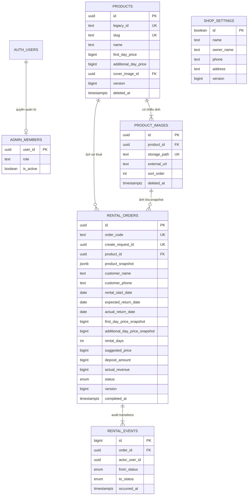

# MIRA RENT — thiết kế cơ sở dữ liệu Supabase

Bộ SQL này phục vụ frontend hiện tại: một cửa hàng, mỗi product là một đơn vị cho thuê, mỗi đơn có một product và chỉ một đơn reserved/active cho mỗi product. Khách xem trang sản phẩm rồi liên hệ shop; chưa có tài khoản khách hàng hoặc đặt thuê online. Frontend mặc định chạy demo; SDK và providers Supabase đã có code, chọn live mode khi cấu hình project.

Xem [BACKEND.md](../BACKEND.md) để triển khai adapters, auth, commands và các giai đoạn tích hợp backend dựa trên schema này.

**Code backend foundation đã có:** đọc [SETUP.md](SETUP.md) để áp dụng migration 04 và bật Supabase mode. Implementation có SDK được lazy-load, async commands và hai providers riêng.

## File và thứ tự áp dụng

| File | Nội dung |
| --- | --- |
| `migrations/20261012000001_mira_schema.sql` | Tables, constraints, indexes, triggers, RLS và read views |
| `migrations/20261012000002_mira_commands.sql` | Product CRUD, đặt/bắt đầu/hủy/hoàn tất thuê, cập nhật settings |
| `migrations/20261012000003_mira_storage.sql` | Bucket ảnh, quyền upload và bảo vệ ảnh lịch sử |
| `migrations/20261012000004_mira_admin_access.sql` | Self-access của caller và bootstrap snapshot có phân quyền |
| `seed.sql` | Demo tùy chọn: 8 sản phẩm, 18 ảnh và 8 đơn từ source hiện tại |
| `tests/database.sql` | Assertions về nghiệp vụ, quyền truy cập và Storage metadata; rollback sau khi chạy |
| `tests/concurrency-*.sql` | Kiểm tra hai session cùng đặt một sản phẩm; chỉ dùng database test |
| `tests/local-bootstrap.sql` | Mock Auth/Storage cho PostgreSQL local, tuyệt đối không chạy trên Supabase |
| `scripts/generate-seed.mjs` | Sinh lại seed từ `src/data`, không chép fixture thủ công |

Các migration chạy một lần, theo thứ tự trên, trên Supabase PostgreSQL 15+. Nếu project đã có tables cùng tên, cần migration nâng cấp riêng thay vì chạy lại bộ khởi tạo. Các file không drop table hoặc reset dữ liệu.

## Mô hình dữ liệu



`shop_settings` chỉ có một row `id=true`. Chủ shop hiển thị là `owner_name`; đây không phải credential đăng nhập. Password/session do Supabase Auth quản lý, không có bảng password riêng trong app.

Tên và điện thoại khách được snapshot trực tiếp trong đơn, có thể để trống như UI hiện tại. Chưa tạo bảng customers vì chưa có CRM hoặc định danh khách; điều này cũng tránh thay đổi thông tin đơn cũ khi khách thay tên/số điện thoại. Nếu sau này có CRM, thêm customer_id tùy chọn nhưng giữ hai trường snapshot.

## Quy tắc chính

- Tiền dùng bigint, đơn vị đồng VND, không dùng float cho giá/cọc/doanh thu. Giá trị từng khoản nằm trong miền số nguyên an toàn của JavaScript.
- Ngày thuê là date; timestamps ghi sự kiện là timestamptz. Báo cáo tháng dùng `Asia/Ho_Chi_Minh`.
- `rental_days` và `suggested_price` là generated columns, database tự tính cả ngày đầu và ngày trả. Client không ghi hai cột này.
- Giá ngày đầu/ngày thêm và product_snapshot được chụp lúc tạo đơn. Đổi giá hoặc tên catalogue không thay lịch sử.
- Product không có cột status có thể ghi. View product_catalog suy ra available/reserved/rented từ đơn mở, nên trạng thái không thể lệch khỏi đơn.
- Partial unique index chặn hai đơn reserved/active cho cùng product, kể cả hai request đồng thời.
- Luồng: available → reserved → active → completed; reserved → cancelled; có thể tạo active trực tiếp. Terminal orders không được sửa/xóa.
- Archive product bằng deleted_at, chặn khi có đơn mở; snapshot lịch sử và media liên quan vẫn giữ.
- Doanh thu = actual_revenue của completed orders, không cộng cọc. Admin vẫn được nhập doanh thu thực tế thủ công, đúng UI hiện tại.
- Khi không truyền actual_revenue cho complete_rental, server tính `max(0, suggested_price + additional_charges - discount)`.
- `version` là token chống lost update. Existing-product save, start/cancel/complete và settings cần version mới nhất; lỗi 40001 yêu cầu reload dữ liệu rồi xử lý lại.
- RPC dùng row locks theo thứ tự product → order và chạy trong transaction. Thất bại ở bất kỳ bước nào rollback cả command.
- Tạo đơn dùng create_request_id; frontend tạo UUID một lần và giữ nguyên khi retry. Payload ban đầu cũng được giữ để chặn dùng lại key cho yêu cầu khác. Retry start/cancel/complete cùng dữ liệu trả bản ghi cũ, không nhân đôi audit hoặc revenue.

Nếu cần nhiều món cùng mẫu, tồn kho theo size hoặc đặt lịch tương lai không chặn toàn bộ product, bổ sung inventory_items/rental_items và kiểm tra giao nhau của lịch thuê. Schema hiện tại cố ý khớp hành vi của app.

## Phân quyền

| Dữ liệu/hành động | Khách chưa đăng nhập | Tài khoản thường | Admin đang hoạt động |
| --- | --- | --- | --- |
| Catalogue, ảnh active, settings | Đọc | Đọc | Đọc |
| Sản phẩm/ảnh archived | Không | Không | Đọc |
| Đơn thuê, khách thuê, audit, doanh thu | Không | Không | Đọc |
| Ghi sản phẩm/đơn/settings trực tiếp | Không | Không | Không |
| Gọi RPC thay đổi dữ liệu | Không | Bị từ chối | Được phép |
| Upload ảnh | Không | Không | Được phép |
| Đổi/ghi đè nội dung ảnh cũ | Không | Không | Không |
| Xóa ảnh còn được dùng/lịch sử tham chiếu | Không | Không | Không |
| Cấp quyền admin | Không | Không | SQL Editor/backend tin cậy |

RLS kết hợp với grants; views dùng security_invoker để giữ chính sách của bảng gốc. Chỉ helper availability được nâng quyền để đọc trạng thái từ đơn, và chỉ trả enum trạng thái của product được phép xem, không trả thông tin khách. Cách dùng view và grants dựa trên [Supabase RLS](https://supabase.com/docs/guides/database/postgres/row-level-security).

Các write RPC SECURITY DEFINER đặt search_path rỗng, gọi require_admin và được giới hạn execute. Quyền admin dựa trên bảng private, không lấy từ user_metadata có thể tự sửa. Xem [Supabase database functions](https://supabase.com/docs/guides/database/functions).

## Chạy trên Supabase

1. Tạo project và mở SQL Editor.
2. Chạy lần lượt nội dung bốn migration. Có thể dùng Supabase CLI migrations nếu đã cấu hình CLI/project riêng; không cần CLI để dùng SQL Editor.
3. Tạo tài khoản quản trị trong Authentication → Users. Đây là tài khoản Auth thật, khác phiên demo hiện tại.
4. Trong SQL Editor, thay email ví dụ bằng email tài khoản vừa tạo rồi chạy:

```sql
insert into mira_private.admin_members(user_id, role)
select id, 'owner'
from auth.users
where lower(email) = lower('email-admin-cua-ban@example.com')
on conflict(user_id) do update set is_active = true, role = 'owner';

-- Kiểm tra có đúng một thành viên được tạo.
select user_id, role, is_active from mira_private.admin_members;
```

5. Nếu là project thử nghiệm và catalogue rỗng, chạy seed.sql. Seed không tạo tài khoản quản trị, không nhập dữ liệu localStorage đang chỉnh sửa và sẽ từ chối nếu đã có product/order. Không seed demo vào dữ liệu vận hành.
6. Chạy tests/database.sql trên project test, không chạy local-bootstrap.sql trên Supabase. Assertions chạy trong transaction và rollback dữ liệu thử nghiệm.
7. Bật Supabase mode theo SETUP.md với URL project, publishable/anon key và Supabase Auth. Service-role/secret key và database connection string chỉ dùng ở server/tooling, không đặt trong biến VITE_*.

Ở CLI, các migrations là nguồn schema được version control. Bộ tests ở đây là plain SQL chạy bằng psql, không phải TAP input cho `supabase test db`.

## Storage

Bucket `mira-product-images` là public vì ảnh catalogue cần hiển thị cho khách. Ảnh public có thể được tải bằng URL; RLS vẫn giới hạn thao tác upload/list/update/delete. Không đưa giấy tờ hoặc dữ liệu khách vào bucket này. Đây là hành vi của [Supabase public buckets và Storage access control](https://supabase.com/docs/guides/storage/security/access-control).

- Giới hạn 8 MiB, MIME JPEG/PNG/WEBP, khớp frontend hiện tại.
- Path chuẩn: `products/<product-uuid>/<image-uuid>.webp` (hoặc jpg/jpeg/png).
- Upload object với upsert=false trước, sau đó save_product với metadata ảnh. Nếu command thất bại, cleanup object chưa được tham chiếu.
- Thay ảnh bằng một UUID/path mới; không ghi đè ảnh cũ.
- Đổi thứ tự và ảnh bìa qua p_images/cover_image_id, trong transaction.
- Ảnh gỡ khỏi sản phẩm được archive. Nếu ảnh bìa đó có snapshot trong đơn, không xóa file.
- `storage_can_delete` cho phép dọn orphan upload hoặc ảnh archived không có đơn tham chiếu.
- Không delete hàng storage.objects bằng SQL để xóa file thực tế; dùng Storage API. SQL insert/delete trong tests chỉ kiểm tra policy với metadata giả lập.

## Tích hợp với frontend hiện tại

| Frontend | Database / cách map |
| --- | --- |
| Product.id | product_catalog.frontend_id = legacy_id hoặc UUID string |
| Product.status | product_catalog.status |
| Product.coverImage | cover_image_id |
| Product.images | product_images active, sắp xếp sort_order |
| ProductImage.url | external_url, hoặc Storage getPublicUrl(storage_path) |
| RentalOrder.id | order_code; UUID nội bộ giữ riêng nếu cần |
| RentalOrder.productId | product_snapshot.id, giữ tương thích legacy routes |
| ProductSnapshot | product_snapshot; resolve coverStoragePath sang coverUrl khi có |
| Giá trong RentalOrder | *_price_snapshot và suggested_price |
| ShopSettings.owner | shop_settings.owner_name |
| createdAt/updatedAt/completedAt | ISO timestamps từ *_at |

`legacy_id` giữ `/san-pham/1`…`/san-pham/8` cho demo/import. Product mới dùng UUID; ảnh dùng UUID. save_product nhận id là UUID hoặc legacy ID của sản phẩm đã tồn tại. Với ảnh upload của product legacy, path vẫn dùng UUID database, không dùng số legacy.

Public load chỉ query product_catalog, product_images active và shop_settings. Admin load thêm rental_orders/rental_events, hoặc dùng rental_history/revenue_by_month. Ngay cả admin cũng lọc deleted_at=null cho catalogue đang hoạt động để UI xóa sản phẩm giữ nguyên hành vi.

Không triển khai SupabaseRepository.save(ShopState) bằng upsert toàn bộ state: cách đó có thể ghi đè dữ liệu của admin khác và sửa lịch sử. Khi tích hợp, đổi ranh giới ghi thành commands cụ thể và cập nhật store theo row RPC trả về; các hàm tính thuần vẫn dùng cho preview/tests.

## Các RPC cho adapter

| RPC | Dùng cho |
| --- | --- |
| save_product(p_product, p_images, p_expected_version) | Thêm/sửa metadata, images và cover; không nhận status |
| archive_product(p_product_ref, p_expected_version) | Xóa khỏi catalogue mà giữ lịch sử |
| create_rental(...) | Đặt hoặc thuê trực tiếp; capture snapshots |
| start_rental(p_order_code, p_expected_version, p_draft) | Bắt đầu thuê, có thể sửa ngày/khách/cọc |
| cancel_reservation(p_order_code, p_expected_version) | Hủy giữ đồ |
| complete_rental(...) | Trả đồ, ghi nhận actual revenue một lần |
| save_shop_settings(p_settings, p_expected_version) | Cập nhật row settings chung |

Payload metadata/draft dùng snake_case giống cột database; product_snapshot giữ camelCase để khớp model. p_images là array theo đúng thứ tự hiển thị; mỗi phần tử có id, display_name và đúng một storage_path hoặc external_url. slug cần duy nhất; khi tên trùng, adapter bổ sung hậu tố slug, vẫn giữ route theo id.

Ví dụ gọi sau khi adapter đã đăng nhập Auth thật:

```ts
const requestId = crypto.randomUUID(); // giữ lại cùng ID nếu retry
const { data, error } = await supabase.rpc("create_rental", {
  p_product_ref: "1",
  p_rental_start_date: "2026-10-12",
  p_expected_return_date: "2026-10-14",
  p_customer_name: "Khách thuê",
  p_customer_phone: "",
  p_deposit_amount: 500000,
  p_notes: "",
  p_start_immediately: false,
  p_request_id: requestId,
});
```

Giữ version của từng row ngoài dữ liệu form và truyền version khi ghi. Không retry lỗi VERSION_CONFLICT một cách mù quáng; tải row mới và đối chiếu ý định của người dùng. Các lỗi chính: 42501 ADMIN_REQUIRED, 40001 VERSION_CONFLICT, 55000 trạng thái không phù hợp/đã hoàn tất, 22023 payload hoặc request key không hợp lệ, 23514 vi phạm check constraint, 23505 trùng slug/ID.

Types cho Database/RPC nên generate từ project đã migrate, thay vì tự ghi types giả. SDK đã có; database.types.ts được sinh từ PostgreSQL áp dụng đủ 01–04. Generate lại theo schema cloud trước khi đổi schema project.

## Kiểm chứng

Đã áp dụng bốn migrations và seed trên PostgreSQL 17.4 local với Auth/Storage metadata giả lập; 67 assertions về RLS/grants, business commands, rollback, snapshot/history, revenue và media protection đạt. Đã kiểm tra hai kết nối đồng thời: một đặt thành công, kết nối còn lại bị PRODUCT_UNAVAILABLE; chỉ có một đơn mở.

Local bootstrap chỉ mô phỏng auth.uid, roles và storage tables; không xác minh dịch vụ Auth/Storage HTTP thật hoặc cấu hình Data API của một Supabase project. Cần chạy lại tests trên project Supabase test sau khi áp dụng migrations, rồi kiểm tra bằng session admin và session thường.

Ví dụ chạy assertions bằng psql trên database test đã migrate:

```powershell
psql -h 127.0.0.1 -p 55439 -U postgres -d mira_validation -v ON_ERROR_STOP=1 -f supabase/tests/database.sql
```

Race test dùng database test mới: chạy concurrency-setup.sql một lần; mở hai session psql, chạy concurrency-a.sql và sau đó concurrency-b.sql trong vòng hai giây. A phải commit, B phải báo PRODUCT_UNAVAILABLE. Cuối cùng chạy concurrency-check.sql. Các file race giữ lại fixture để kiểm tra, không dùng trên database vận hành.

Regenerate seed khi thay demo fixtures:

```powershell
node --import ./scripts/register-typescript.mjs supabase/scripts/generate-seed.mjs
```
